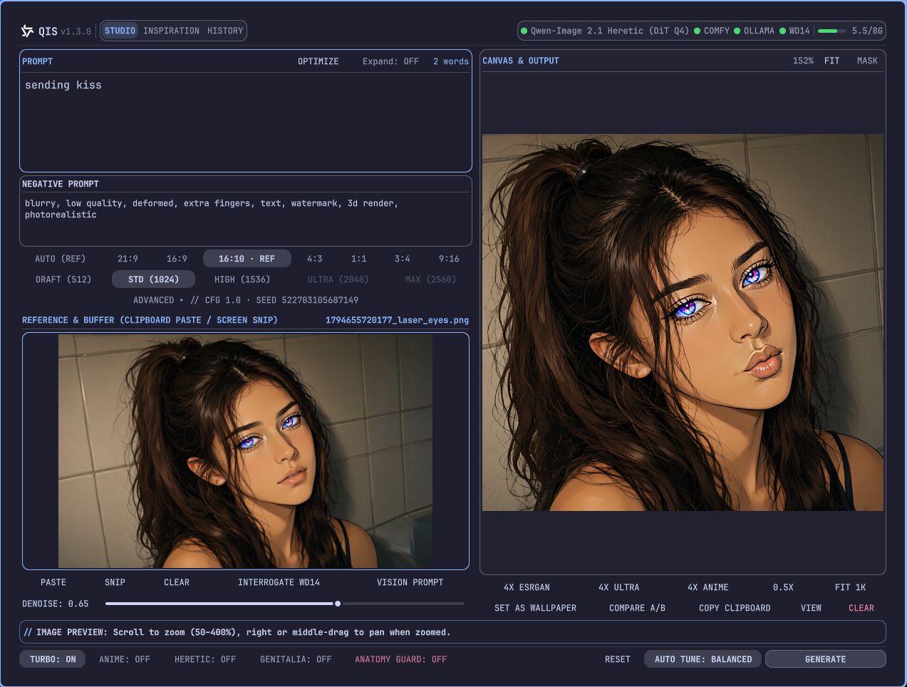
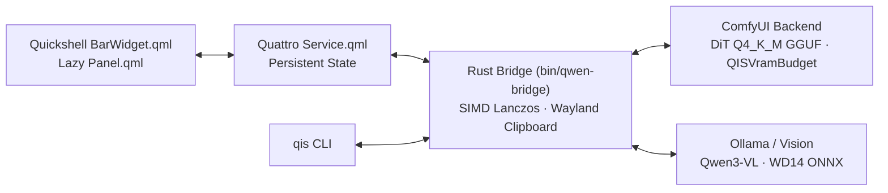

# QIS — Qwen Image Studio

[](https://omarchyplugins.com/plugin.html?id=simonez.qwenimage)
[](https://github.com/simonezpx3/omarchy-qwenimage/releases/tag/v1.3.0)
[](https://github.com/simonezpx3/omarchy-qwenimage/actions/workflows/ci.yml)
[](LICENSE)
[](#architecture)
[-orange.svg)](#architecture)

## TL;DR

**QIS** is a local-first generative AI studio for **Omarchy Linux / Hyprland (Wayland)** combining a lazy-loaded **Quickshell (QtQuick/QML)** interface, a native **Rust** orchestration bridge (`bin/qwen-bridge`), and a **ComfyUI (DiT Q4_K_M GGUF) + Ollama** backend—with zero cloud dependencies and zero API costs.

> [!IMPORTANT]
> **Built for `<= 8 GB` VRAM GPUs.** `QISVramBudget` dynamically reserves `0.9–1.6 GB` for the Wayland compositor, bypasses `EasyCache` when LoRAs are active (preventing 192 MiB SwiGLU collisions), and falls back to `VAEDecodeTiled` (`512px` tiles, `64px` overlap) to drop peak VAE decode memory from `576 MiB` to `< 80 MiB`.

> [!TIP]
> **Zero-stutter live previews.** TAEQI 2.1 WebSocket previews stream atomically into `/dev/shm/qis_preview_${UID}/`, and `Panel.qml` unmounts its QML tree when closed (`active: root.opened`) to minimize resident shell memory.

## Interface



## Architecture



## Key Capabilities

| Area | Implementation |
| :--- | :--- |
| **Diffusion & Speed** | DiT Q4_K_M GGUF via ComfyUI, PyTorch 2.x SDPA (optional SageAttention 2), **6-step Turbo DMD** (~5s), instant `CANCEL` with VRAM release |
| **Adapters & Upscaling** | Tri-state LoRAs (`Heretic`, `Anime`, `Anatomy`: `OFF / SOFT / FULL`), `4X ESRGAN / UltraSharp / AnimeSharp`, Rust **SIMD Lanczos** (`AVX2`/`NEON`) |
| **Prompt & Vision Tools** | **WD14** Danbooru tagger, **Qwen3-VL** vision reverse-engineering, **Civitai Explorer** (1-click apply / 2-click generate) |
| **Wayland & Inspection** | `slurp` + `grim` screen `SNIP`, universal clipboard intake (`16 KiB` text / `32 MiB` image bounds), `imv` fullscreen viewer, A/B split compare |
| **Interactive Mask & Inpaint** | Brush mask canvas over output with separated base image vs. reference input for targeted `I2I` inpainting |
| **Process Hardening** | `PR_SET_PDEATHSIG` (`SIGKILL`), `systemd-run --user --scope`, `flock` cooperative GPU lock (`VramLockGuard`), 24h tmpfs GC |

## Quickstart & Hardware Tiers

```bash
# 1. Install via Omarchy Plugin Manager (recommended — runs install.sh in-place)
omarchy plugin add https://github.com/simonezpx3/omarchy-qwenimage.git --enable

# 2. Manage backend, models, and updates via CLI
qis start --bg                          # Start backend scope
qis status                              # Health matrix, VRAM reserve & tier
qis update [all|plugin|comfy|models]    # Granular stack updates
```

| Tier | VRAM | Profile |
| :--- | :--- | :--- |
| **Tier S** | `>= 16 GB` | Full FP8 / BF16 weights |
| **Tier A** | `8 – 12 GB` | GGUF `Q4_K_M` DiT + Qwen3-VL 8B + `QISVramBudget` |
| **Tier B** | `6 GB` | GGUF `Q3_K_S` DiT + Qwen2.5-VL 3B + sequential CPU offload |
| **Tier C** | `<= 4 GB` / iGPU | Remote LAN ComfyUI backend (local UI client mode) |

## Security, Controls & Credits

<details>
<summary><strong>Supply-Chain Security, Shortcuts, Uninstall & Upstream Credits</strong></summary>

- **Supply-Chain Baseline:** ComfyUI (`v0.41.2`) and custom nodes pinned to commit SHAs; Python deps locked via `pip install --require-hashes` (`locks/`); native binary verified via `bin/qwen-bridge.sha256`.
- **Key Shortcuts:** `Ctrl + Enter` (Generate) · `Ctrl + V` / `Super + V` (Paste reference) · `Esc` (Close / back to Studio).
- **Uninstall:** `omarchy plugin remove simonez.qwenimage` or `./uninstall.sh [--purge-settings | --purge-all]`.

</details>

## Acknowledgments & Upstream Credits

QIS builds upon the work of open-source creators and AI researchers whose technologies make local inference possible:

- **[ComfyUI](https://github.com/comfyanonymous/ComfyUI)** by [@comfyanonymous](https://github.com/comfyanonymous) – Node-based execution engine powering the local diffusion pipeline.
- **[ComfyUI-GGUF](https://github.com/city96/ComfyUI-GGUF)** by [@city96](https://github.com/city96) – GGUF quantization loader enabling DiT models to run within consumer VRAM limits.
- **[Qwen-Image / Qwen2.5-VL](https://github.com/QwenLM)** by the **Qwen Team (Alibaba Cloud)** – Foundation models for generative image synthesis and visual understanding.
- **[Viggle AI](https://huggingface.co/Viggle/Qwen-Image-2.1-viggle-turbo)** by [@Viggle](https://viggle.ai/) – 6-step DMD (Distribution Matching Distillation) LoRA architecture and custom scheduler.
- **[chfm](https://huggingface.co/chfm/Qwen-Image-2.1-Text-Encoder-Heretic-GGUF)** – Qwen3-VL 8B Heretic GGUF text encoder reducing false-positive prompt refusals while maintaining semantic alignment.
- **[abenzerps](https://huggingface.co/abenzerps/Qwen-Image-2.1-Uncensored-GGUF)** – Uncensored latent LoRA adapter.
- **[WarmBloodAban](https://huggingface.co/WarmBloodAban/Qwen-Image-2.1-LoRAs)** – Anime consistency LoRA adapter.
- **[Quickshell](https://github.com/outfoxxed/quickshell)** by [@outfoxxed](https://github.com/outfoxxed) – Reactive QtQuick/Wayland shell environment.
- **[WD14 Tagger](https://github.com/pythongosssss/ComfyUI-WD14-Tagger)** by [@pythongosssss](https://github.com/pythongosssss) & [@SmilingWolf](https://github.com/SmilingWolf) – Anime and photography tag interrogation models.
- **[TAEQI / Tiny AutoEncoder](https://github.com/madebyollin/taesd)** by [@madebyollin](https://github.com/madebyollin) – Lightweight latent autoencoder powering real-time step previews.
- **[Real-ESRGAN](https://github.com/xinntao/Real-ESRGAN)** by [@xinntao](https://github.com/xinntao) & **[Comfy-Org](https://huggingface.co/Comfy-Org/Real-ESRGAN_repackaged)** – Super-resolution architecture and repackaged weights.
- **[4x-UltraSharp & 4x-AnimeSharp](https://huggingface.co/Kim2091)** by [@Kim2091](https://huggingface.co/Kim2091) – Super-resolution checkpoints for micro-contrast and linework restoration.
- **[Civitai](https://civitai.com/)** – Community platform for prompt engineering and open model sharing.
- **[Omarchy Linux & Hyprland](https://github.com/hyprwm/Hyprland)** – Wayland tiling desktop ecosystem.

## License

[MIT License](LICENSE)
