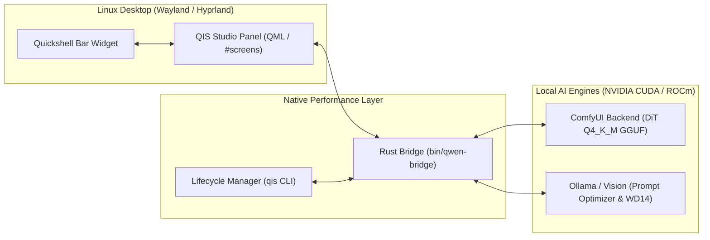

# QIS (Qwen Image Studio)

[](https://github.com/simonezpx3/omarchy-qwenimage/releases/tag/v1.2.1)
[](https://github.com/simonezpx3/omarchy-qwenimage/actions/workflows/ci.yml)
[](LICENSE)
[](#)
[](#)
[-orange.svg)](#)
[-success.svg)](#)

Universal Local-first Generative AI Studio for **Linux** (Wayland / Quickshell / Omarchy).

Designed for high-performance local diffusion inference with zero cloud dependencies and zero token costs.


---

## Architecture Overview

QIS connects the reactive QtQuick/QML interface with native system acceleration and local AI engines:



---

## Interface Tour

| Studio & Canvas | Prompt & Inspiration Explorer | History & Local Archive |
|---|---|---|
|  |  |  |

---

## Features

- **Text-to-Image (DiT Diffusion):** Native high-resolution generation via local ComfyUI backend.
- **SageAttention 2 Acceleration:** Hardware-accelerated INT8 Tensor Core matrix operations (`sm_86` Ampere and newer) cutting attention memory footprint and delivering 25–35% faster sampling without altering GGUF model weights.
- **Zero-Copy POSIX Shared Memory Previews (`/dev/shm`):** Live step previews written directly to dedicated RAM disk (`/dev/shm/qis_preview_${UID}/`) with atomic renaming, eliminating disk I/O latency and micro-stutter on 144Hz Wayland compositors.
- **Process Lifecycle Hardening & Zombie Protection:** Kernel-level process tracking via `libc::prctl(PR_SET_PDEATHSIG, SIGKILL)` and transient systemd scopes (`systemd-run --user --scope`), ensuring instant GPU VRAM eviction and zero orphan processes if the parent bridge aborts.
- **Complete Bilingual Parity (EN / CS):** Dynamic language switcher with zero English leaks across UI labels, tooltips, bridge error messages, and desktop notifications.
- **Turbo Mode (Viggle Turbo DMD):** 6-step distillation with zero-redundancy MLP hooks yielding ~5s generation on consumer GPUs (8GB+ VRAM, enforcing a strict 1.8 GB VRAM system reserve) at 0 token cost, seamlessly toggleable from the bottom action bar.
- **Neural Super-Resolution (4X Upscalers):** Integrated zero-token super-resolution suite directly in ComfyUI:
  - `4X ESRGAN` (RealESRGAN_x4plus) — General photo & cinematic restoration with grain denoising.
  - `4X ULTRA` (4x-UltraSharp) — Micro-contrast and high-frequency tactile texture preservation.
  - `4X ANIME` (4x-AnimeSharp) — Crisp cell-shaded vector-like linework without ringing artifacts.
  - `0.5X` & `FIT 1K` — Instant downsampling and viewport boundary fitting.
- **SIMD Lanczos Resizer:** Hardware-accelerated image resampling (AVX2, NEON, and portable fallback in Rust) via `bin/qwen-bridge scale-lanczos`, delivering instant high-fidelity scaling without Python or GPU runtime overhead.
- **Low-Memory UI Texture Pipeline:** Adaptive `sourceSize` viewport constraint in QML decoupling physical canvas dimensions from render textures, slashing UI RAM/VRAM consumption from ~92 MB to ~4 MB while strictly preserving original aspect ratios.
- **Automated Tmpfs Housekeeping:** Native Rust garbage collection sweeping runtime preview artifacts older than 24 hours, paired with a 10 MB circular log rotator on ComfyUI execution streams.
- **Screen Area Snip & Reference Buffer Controls:** Direct geometry screen capture (`grim` + `slurp`) into runtime tmpfs buffers via `SNIP`, paired with instant one-click buffer eviction (`CLEAR`) without polluting the system clipboard.
- **Interactive History & Wayland Fullscreen Viewer:** Direct ingestion of past generations back into the Studio reference buffer (`COPY TO BUFFER` / `DO BUFFERU`) and instant zero-latency fullscreen inspection (`VIEW` / `ZOBRAZIT`) powered by `imv` (`imv -i imv-fullscreen -f -c "bind <Escape> quit"`).
- **A/B Compare Interactive Splitter:** Dedicated dual-buffer inspection view (`views/CompareView.qml`) with real-time slider split to optically evaluate generation quality, prompts, and aspect scaling variations side-by-side.
- **Hardened Wayland Sandbox & Input Isolation:** Fully bounded Wayland clipboard intake (16 KiB ceiling, 1.2s timeout with SIGKILL fallback) and pure `FocusScope` event interception completely neutralizing foreign MIME starvation, DoS freezes, and primary selection leaks.
- **Heretic LoRA (Abliterated Uncensored Latent):** Dedicated uncensored diffusion adapter for uninhibited artistic freedom, with dynamic LoRA weight governor preventing tensor saturation.
- **Anatomical Safety Guard:** Intelligent anatomy preservation automatically enforcing a standard resolution floor (1024 px) and adaptive Euler sampling profile when human subjects, portraits, or erotic themes are detected in draft mode.
- **Live TAEQI 2.1 Previews:** Real-time intermediate diffusion preview streaming over WebSocket directly from ComfyUI (0 VRAM overhead, decoded via ultra-fast TAEQI into RAM-disk tmpfs).
- **Quick Step Presets:** Instant step selection (`15`, `25`, `35`) with active state highlight and live elapsed timer.
- **Universal Wayland Clipboard Engine:** Deep Rust integration decoding raw image formats (PNG, JPEG, WebP, BMP, TIFF), file manager URIs (`file://` from Nemo, Thunar, Nautilus), and web image URLs directly into the reference buffer.
- **Instant Generation Interrupt & Cancel:** Dynamic `CANCEL // Xs` (`PŘERUŠIT // Xs`) button during active diffusion paired with a dedicated `interrupt_comfyui()` engine and `isCancelling` state machine in Rust bridge, instantly stopping the diffusion loop in ComfyUI and releasing GPU memory.
- **Image-to-Image & Aspect Ratio Overrides:** Automatic aspect ratio extraction when set to `auto`, and explicit user aspect ratio enforcement (`21:9`, `16:9`, `16:10`, `4:3`, `1:1`, `3:4`, `9:16`) with center-crop scaling when specific proportions are desired.
- **Anime LoRA & Adaptive Resolution Profiling:** Instant anime style injection and VRAM-aware resolution presets (`standard`, `performance`, `high`).
- **WD14 Tag Interrogator:** Fast Danbooru tag extraction via ONNX / ViT models.
- **Vision Prompt Engineering:** Reverse-engineering existing scenes into rich diffusion prompts.
- **Civitai Explorer:** Curated prompts, negative prompts, and generation settings browser with single-click apply and double-click instant generation.
- **Hardened Rust Bridge & Regression Suite:** High-performance native bridge (`bin/qwen-bridge`) equipped with a 4096-character buffer clamp, automated LLM JSON prompt envelope unpacking, toxic foreign tag sanitization (`<lora:...>`, `<embedding:...>`), and an automated unit test suite.
- **Dynamic Output Node Resolution:** Resilient backend listener that dynamically detects SaveImage nodes across custom workflows instead of relying on fixed node indices.
- **Omarchy UI Architecture:** Pixel-perfect geometric harmony with `Style.cornerRadius`, concentric surface depth, cybernetic reticle corners, and zero box-clutter.
- **Tabular Numerals & Optical Stability:** OpenType `tnum` tabular numerals across diffusion step badges, timers, and VRAM telemetry eliminating horizontal layout jitter.
- **Clean Live System Telemetry:** Button-free header telemetry badges showing connected Qwen model, ComfyUI (v0.41.2), Ollama, CUDA, Quickshell, and real-time VRAM utilization indicator (with 1.8 GB safety reserve).
- **In-Button Live Timers:** Dynamic, non-intrusive second counters inside active buttons (`GENERATE`, `OPTIMIZE`, `TAGS`, `SCALE`).
- **Wallpaper Integration:** One-click wallpaper deployment to Omarchy and Hyprland.

---

## Interactive Controls & Shortcuts

| Action / Gesture | Trigger | Result |
|---|---|---|
| **Toggle Studio Panel** | Click on bar widget or `omarchy-shell simonez.qwenimage toggle` | Opens/closes the floating studio window |
| **Instant Generation** | `Ctrl + Enter` in prompt or negative prompt | Immediately launches diffusion synthesis |
| **Turbo Mode Toggle** | Click on `TURBO: ON // OFF` in bottom bar | Toggles 6-step DMD acceleration (~5s) vs standard 28-step Euler sampling |
| **Heretic LoRA Toggle** | Click on `HERETIC: ON // OFF` in bottom bar | Toggles uncensored latent diffusion adapter |
| **Anime LoRA Toggle** | Click on `ANIME: ON // OFF` in bottom bar | Toggles SD_Tutorial anime and illustration stylization adapter |
| **Paste Reference Image** | Click on reference preview box, `Ctrl + V`, or `Super + V` | Decodes image or local file path from Wayland clipboard |
| **Screen Area Snip** | Click on `SNIP` in Studio reference box | Interactively snips screen geometry (`slurp` + `grim`) directly into reference buffer |
| **Clear Reference Buffer** | Click on `CLEAR` (`SMAZAT`) next to `SNIP` | Immediately clears the active reference image from the Studio buffer |
| **History to Reference Buffer** | Click on `DO BUFFERU` (`COPY TO BUFFER`) in History view | Loads a previously generated image directly into the Studio reference buffer |
| **Fullscreen Image View** | Click on `ZOBRAZIT` (`VIEW`) in History view | Opens the generated image in a native Wayland fullscreen viewer (`imv`, press `Esc` to quit) |
| **A/B Compare View** | Click on `COMPARE` in Studio bottom bar | Opens dual-buffer interactive slider compare view |
| **CivitAI Quick Apply** | Single click on any prompt card | Loads prompt and parameters into Studio |
| **CivitAI Direct Synthesize** | Double click on any prompt card | Loads prompt and triggers immediate generation |
| **Return to Studio** | `Esc` from A/B Compare or History views | Navigates back to main Studio view |
| **Close Studio** | `Esc` or click outside | Smoothly closes the window and frees viewport |
| **CLI & Stack Update** | `qis update [all|plugin|comfy|models]` | Updates plugin, Rust bridge, ComfyUI core, or models via CLI |
| **Live Telemetry** | Automatic background polling (default: 3s) | Real-time hardware and VRAM header telemetry without manual header buttons |

---

## Hardware Tier Profiling

QIS automatically profiles your hardware on installation and suggests the optimal runtime configuration:

| Tier | VRAM | Recommended Configuration |
|---|---|---|
| **Tier S** | $\ge$ 16 GB | Full FP8 / BF16 direct weights, maximum generation speed. |
| **Tier A** | 8 – 12 GB | GGUF Q4_K_M DiT + Qwen3-VL 8B Text Encoder with dynamic VRAM management and SageAttention 2 acceleration. |
| **Tier B** | 6 GB | GGUF Q3_K_S DiT + Qwen2.5-VL 3B Text Encoder with sequential CPU offload. |
| **Tier C** | $\le$ 4 GB / iGPU | Remote LAN cluster execution via network ComfyUI backend. |

---

## Installation & Setup

### Option A: Omarchy Plugin Manager (Recommended)
```bash
omarchy plugin add https://github.com/simonezpx3/omarchy-qwenimage.git
```
*Note: `omarchy plugin add` automatically triggers an in-place execution of `install.sh`.*

### Option B: Standalone / Manual Setup
```bash
git clone https://github.com/simonezpx3/omarchy-qwenimage.git
cd omarchy-qwenimage
chmod +x install.sh
./install.sh
```

During installation (both automatic in-place and manual), `install.sh` will:
1. Profile GPU vendor (NVIDIA, AMD, Intel) and detect available VRAM.
2. Check for ComfyUI and diffusion models; if missing on new hardware, offer one-click automated stack installation.
3. Deploy the native bridge binary `bin/qwen-bridge`.
4. Deploy the `qis` management CLI into `~/.local/bin/qis`.
5. Validate plugin schema via `omarchy plugin validate`.
6. Register the plugin cleanly into the Omarchy bar layout.
7. Perform safe IPC hot-reload.

---

## Lifecycle & Updater CLI (`qis`)

Once installed, manage the entire ecosystem with the `qis` command:

```bash
qis                                     # Interactive management menu (Setup, Update, Models, Rollback)
qis start [--bg]                        # Start the QIS backend stack (use --bg to run as background daemon)
qis stop                                # Gracefully stop running ComfyUI and release GPU VRAM
qis status                              # Displays dependency health matrix, VRAM reserve, and hardware profile
qis setup                               # Automated installation of ComfyUI (v0.41.2), custom nodes, and models
qis update [all|plugin|comfy|models]    # Granular or full update of QIS plugin, ComfyUI core, or models
qis models                              # List and manage installed diffusion checkpoints, GGUF weights, and LoRAs
qis rollback                            # Revert ComfyUI to previous working checkpoint
```

---

## Security & Supply-Chain Baseline

This plugin strictly complies with the Omarchy Marketplace Security Baseline:
- **Pinned Git Commits:** ComfyUI core (v0.41.2) and all custom nodes are pinned to immutable commit SHAs.
- **Cryptographic Hash Verification:** All Python packages and sub-dependencies are locked with strict SHA-256 hashes (`pip install --require-hashes`) across CUDA 12.8, ROCm 6.2, and CPU architectures in `locks/`.
- **Zero Unpinned Execution:** No unhashed or arbitrary code is downloaded during clone, install, or update operations.

---

## Uninstallation

```bash
# Via Omarchy plugin manager:
omarchy plugin remove simonez.qwenimage

# Or directly via uninstaller script:
./uninstall.sh [--purge-settings | --purge-all]
```
- `./uninstall.sh` — Removes plugin registration, CLI symlink, and Bar widget while keeping user configurations and models intact.
- `./uninstall.sh --purge-settings` — Additionally removes user configuration files and state caches.
- `./uninstall.sh --purge-all` — Complete teardown: removes plugin, settings, local ComfyUI environment, and all downloaded AI models.

---

## Acknowledgments & Upstream Credits

QIS stands on the shoulders of giants. We express our gratitude to the open-source creators and AI researchers whose technologies make local, zero-token generation possible:

- **[ComfyUI](https://github.com/comfyanonymous/ComfyUI)** by [@comfyanonymous](https://github.com/comfyanonymous) – The revolutionary node-based engine powering our local diffusion pipeline.
- **[ComfyUI-GGUF](https://github.com/city96/ComfyUI-GGUF)** by [@city96](https://github.com/city96) – Essential GGUF quantization loader enabling DiT models to run smoothly within consumer VRAM limits.
- **[Qwen-Image / Qwen2.5-VL](https://github.com/QwenLM)** by the **Qwen Team (Alibaba Cloud)** – Groundbreaking foundation models for generative image synthesis and visual understanding.
- **[Viggle AI](https://huggingface.co/Viggle/Qwen-Image-2.1-viggle-turbo)** by [@Viggle](https://viggle.ai/) – 6-step DMD (Distribution Matching Distillation) LoRA architecture and custom scheduler delivering 5x inference speedups on consumer hardware.
- **[chfm](https://huggingface.co/chfm/Qwen-Image-2.1-Text-Encoder-Heretic-GGUF)** – Qwen3-VL 8B Heretic GGUF text encoder eliminating false prompt rejections while maintaining semantic alignment.
- **[abenzerps](https://huggingface.co/abenzerps/Qwen-Image-2.1-Uncensored-GGUF)** – Dedicated uncensored latent LoRA adapter providing complete artistic liberty.
- **[WarmBloodAban](https://huggingface.co/WarmBloodAban/Qwen-Image-2.1-LoRAs)** – Anime consistency LoRA adapter ensuring refined stylistic rendering.
- **[Quickshell](https://github.com/outfoxxed/quickshell)** by [@outfoxxed](https://github.com/outfoxxed) – The lightning-fast, reactive QtQuick/Wayland environment that gives QIS its sub-millisecond desktop responsiveness.
- **[WD14 Tagger](https://github.com/pythongosssss/ComfyUI-WD14-Tagger)** by [@pythongosssss](https://github.com/pythongosssss) & [@SmilingWolf](https://github.com/SmilingWolf) – State-of-the-art anime & photography tag interrogation models.
- **[TAEQI / Tiny AutoEncoder](https://github.com/madebyollin/taesd)** by [@madebyollin](https://github.com/madebyollin) – Ultra-fast, lightweight latent autoencoder powering real-time zero-VRAM step previews.
- **[Real-ESRGAN](https://github.com/xinntao/Real-ESRGAN)** by [@xinntao](https://github.com/xinntao) & **[Comfy-Org](https://huggingface.co/Comfy-Org/Real-ESRGAN_repackaged)** – Foundation super-resolution architecture and repacked weights providing 4X super-resolution and cinematic denoising.
- **[4x-UltraSharp & 4x-AnimeSharp](https://huggingface.co/Kim2091)** by [@Kim2091](https://huggingface.co/Kim2091) – State-of-the-art super-resolution checkpoints delivering exceptional micro-contrast and clean cell-shaded vector-like linework.
- **[Civitai](https://civitai.com/)** – For fostering a vibrant community of prompt artists, checkpoint creators, and open model sharing.
- **[Omarchy Linux & Hyprland](https://github.com/hyprwm/Hyprland)** – For providing the premier Wayland tiling desktop ecosystem.

---

## License

[MIT License](LICENSE). Developed by simonez & Arci.

---

## Disclaimer

QIS is an independent open-source project and is not affiliated with, sponsored, or endorsed by Alibaba Group, Google, or ComfyUI.
